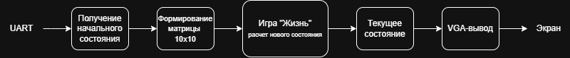

## О проекте

Game of Life — клеточный автомат, состоящий из набора клеток, каждая из которых может находиться в одном из двух состояний:

- живая

- мёртвая

Состояние каждой клетки в следующем поколении определяется состояниями её восьми соседей.

В данном проекте игровое поле имеет размер 10×10 клеток.

Смена поколений выполняется с заданным периодом. Для формирования момента перехода к следующему поколению используется отдельный модуль делителя частоты.

## Основные возможности

- аппаратная реализация Conway's Game of Life;

- игровое поле размером 10×10 клеток;

- загрузка начального состояния через UART;

- автоматическое вычисление следующих поколений;

- периодическая смена поколений;

- вывод состояния игрового поля через VGA;

- разрешение VGA 640×480;

- модульная структура проекта;

- реализация на Verilog.

## Структурная схема
Общая структура проекта представлена на следующей схеме:

Основной вычислительный блок проекта — game_logic. Он получает начальное состояние игрового поля, рассчитывает следующее поколение и хранит текущее состояние матрицы.

Отдельный модуль clk_divider формирует управляющий импульс cr_new_gen, по которому выполняется переход к следующему поколению.

После этого состояние игрового поля используется для формирования изображения, выводимого через VGA.

## Правила Conway's Game of Life

Для каждой клетки применяются следующие правила.

### Живая клетка

Если клетка живая:

- при наличии менее двух живых соседей она погибает;

- при наличии двух или трёх живых соседей она остаётся живой;

- при наличии более трёх живых соседей она погибает.

### Мёртвая клетка

Если клетка мёртвая:

- при наличии ровно трёх живых соседей она становится живой;

- во всех остальных случаях остаётся мёртвой.

## Сборка проекта

Основные этапы сборки:

1. Открыть файл проекта .qpf.

2. Проверить выбранное FPGA-устройство.

3. Проверить Top-Level Entity.

4. Проверить назначения выводов FPGA.

5. Запустить компиляцию проекта.

6. Получить файл прошивки .sof.

7. Загрузить прошивку в FPGA.

## Запуск

После загрузки прошивки в FPGA:

1. FPGA принимает начальное состояние игрового поля через UART.

2. Полученная матрица 10×10 передаётся в game_logic.

3. Начальное состояние отображается через VGA.

4. clk_divider периодически формирует cr_new_gen.

5. game_logic рассчитывает следующее поколение.

6. Новое состояние отображается на экране.

7. Процесс повторяется автоматически.

## Используемые технологии

- Verilog

- FPGA

- Intel Quartus Prime

- UART

- VGA

- Conway's Game of Life

- цифровая логика и синхронные регистры

## Результат работы

На VGA-дисплее отображается текущее состояние клеточного автомата.

Начальное состояние игрового поля может быть передано через UART, после чего FPGA самостоятельно выполняет расчёт последующих поколений.

## Авторы
Ярослав Хромеев

Николай Петров

Кирилл Попов

## Лицензия
Проект создан в учебных целях.
